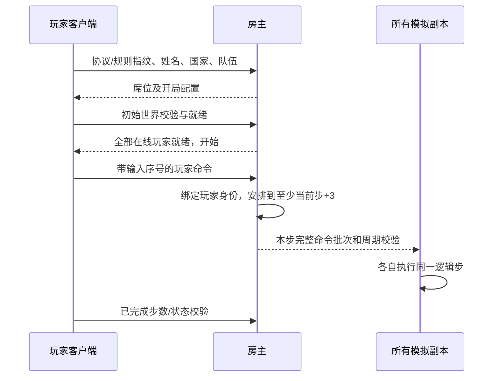

# 模拟、联机与验证边界

## 独立模拟

[Simulation](Simulation/) 是不依赖 Godot 的 `net10.0` 类库。每秒 20 个逻辑步，每格 1024 个整数坐标单位。移动、距离、采矿、生产、攻击、迷雾、胜负和寻路使用整数；距离归一化使用整数平方根。Godot 只消费状态、接收输入和传送命令，不参与碰撞或导航判定。

每步按玩家与输入序号排序命令，随后更新电力、建筑、单位、胜负、清理和迷雾。寻路采用固定邻居顺序及包含格子编号的优先级，单步最多 48 次搜索。单位服务顺序由逻辑步和单位数量确定性轮换；失败搜索退避 10–16 步，新目标或导航版本变化会重新允许搜索，避免被围住的早期单位长期占满预算。占用网格在单位更新前重建，生产出生和移动会增量更新；该缓存不作为持久世界状态。迷雾圆形视野使用预计算的整数圆扫描行，并以连续 Span 填充，保持原逐点结果；模拟库在 Debug 构建中也启用优化并保留 PDB。

阵营和国家分别建模。英、美、法共用盟军基础科技，俄罗斯使用苏军；特色兵种/建筑由国家限制。训练场对手是显式、简单的命令生成器，没有复用其它项目的 AI。

## 房间与命令时序

[NetworkSession](Scripts/NetworkSession.cs) 直接轮询 Godot 的 `ENetMultiplayerPeer`，使用可靠有序传输。场景节点没有网络复制或 RPC 同步。

普通房主占一席，最多再接七位玩家；独立服务端不占席，允许八位客户端。开局前重新分配连续席位，避免大厅退人后留下空洞。开局后拒绝加入。就绪期间掉线也会释放加载屏障并排入投降命令；对战掉线按同样的规范命令处理。初次连接最多等待约十秒，之后报告连接失败。

客户端提交的玩家编号和执行步不被信任，由房主绑定真实席位并安排执行。模拟再次检查归属、资金、科技、地图、队伍与目标。小队中的阵亡单位被忽略，混入存活敌军的选择整体拒绝。未执行的未来输入不计入录像。

输入固定延迟为 3 步，即 150 ms，另加网络和处理等待。客户端只在收到规范批次后前进。房主最多领先最慢的在线客户端 80 步，超过后等待，避免无限积压；当前没有预测、回滚、快照追赶或重连。

单个应用层消息限制 60,000 字节。房主每步累计命令序列化体积限制 45,000 字节、最多 128 条，过多输入可排到随后最多 40 步，并保持各玩家的输入顺序。每位玩家每 20 步最多接受 64 条输入。ENet 负责底层分片、可靠性和重排。

## 校验和录像

每 20 步比较一次显式稳定哈希，覆盖玩家、实体、生产队列、订单、路径、失败重试时间、矿量、迷雾、编号和导航版本等未来相关状态。显示用的摄像机、像素、纹理、浮点投影和墙钟时间不进入模拟。

握手和录像包含协议及规则指纹。规则指纹包含规则表和手工维护的模拟版本（当前为 `command-alpha-5`）；改变会影响模拟结果或持久状态的算法时需要更新版本。它不自动证明两份程序源码相同。多进程测试另外保留实际程序集 SHA256 和构建快照路径，便于追溯。

[ReplayFile](Simulation/Replay.cs) 保存开局配置、已经执行的规范命令、最终步数和校验。重演从相同配置创建新世界，逐步执行并检查最终状态。UI 保存的是当时已经执行的前缀，不包含尚在输入队列中的命令。当前提供保存和无窗口重演校验，尚无可视化录像播放器。

客户端持有完整世界，以便确定性模拟。迷雾在显示和目标命令层生效，因此这版架构适合学习和朋友间对战；没有实现服务器隐藏信息视图或竞技服务。

## 图形与原版格式

[ArtLibrary](Scripts/ArtLibrary.cs) 读取独立 C# 转换器的输出。SHP 保留裁剪、画布偏移、阴影配对和原索引；VXL/HVA 在离线三维深度缓冲中烘焙为真正的 32 朝向图集，车体、炮塔和炮管使用同一画布/锚点。HVA 与 VXL 按 section 序号关联，原版部分文件的 section 名称不同。

运行时仅对原索引 16–31 的区域换队伍色，保留其它像素和原有亮度。全部图片缓存、临时 Image、Theme 和 StyleBox 明确释放，headless 验证同时检查退出清理。建筑对齐参考公开的像素偏移数据，来源 URL 与内容 SHA256 随生成数据记录。

VXL 光照目前根据外露体素面近似，原始 normal 索引仍保留；尚未实现原引擎光表、体素损伤、原版阴影和完整附加动画。地面采用程序绘制。

## 验证范围

[verify_headless.py](Tools/verify_headless.py) 构建当前项目并调用真实 Godot 场景、输入处理和 ENet。它检查进程退出状态与引擎错误，保留独立报告；多进程比赛使用冻结的程序集，避免后续编译影响运行中的测试。

覆盖：

- 2–8 人初始化与第九位拒绝、国家限制、资金、电力、建造健康增长、队列、采矿守恒、捕获、护甲目标、队伍迷雾和胜负清理。
- 被封闭的早期部队不阻止后来单位寻路；同一命令流与序列化重演产生相同状态。
- 鼠标/键盘驱动的选兵、移动、编组、建造、生产与取消；真实图集加载和绘制回调。
- 大厅退人后的开局、加载期间掉线、初始连接失败、长输入批次及分步排队顺序。
- 两进程、八进程、独立服务端加八客户端，以及真实 UDP 丢包/延迟代理下的状态与录像一致性。

压力计时只测模拟逻辑，不能推导窗口帧率或 GPU 性能。联机验收在当前机器上使用独立进程，尚未验证跨平台、真实公网多地、长时间比赛或断线重连。最终数据见 [验证记录](Reports/VALIDATION.md)。
