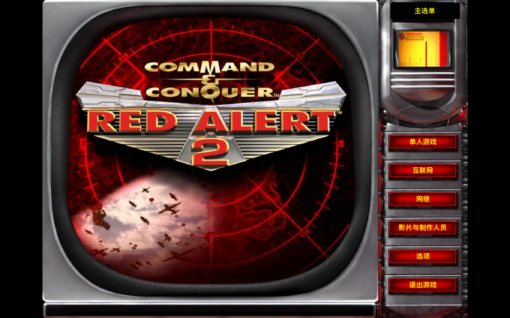

# 发行版菜单重做与原生验收

根据用户“字体没关系，主要是 UI 样式和操作逻辑和原版一致”的要求，重新联网核对原版画面和手册，替换第一版只相似于结构的外壳。当前已在鸿蒙原生 Godot 窗口直接看图检查主菜单、选项、网络大厅、房间和遭遇战页，并验证真实 ENet 联机。

## 画面与来源

主菜单使用原版完整雷达影片：标志、红色地球／雷达、穿插镜头、黑色 CRT 内框与银色外框均来自原片；右侧按钮为独立 Godot 交互控件，使用原始红色 mnbttn SHP 帧。字体采用当前环境可用字体，没有追求原版字体一致。

参考依据为 [Version 1.0 主菜单截图](https://www.mobygames.com/game/2544/command-conquer-red-alert-2/screenshots/windows/10837/)、[2001年 Options 截图](https://www.mobygames.com/game/2544/command-conquer-red-alert-2/screenshots/windows/14417/)、[原生 RA2 1.006 网络大厅](https://www.tlukas.eu/uvod/red-alert-2-multiplayer)及[原始零售手册](http://nyerguds.arsaneus-design.com/manuals/Red%20Alert%202/Red%20Alert%202%20-%20English.pdf)。详细版本、截图、操作事实与证据缺口保留在[参考事实](../Assets/Reference/FrontEndResearch/FACTS.md)和[来源清单](../Assets/Reference/FrontEndResearch/provenance.json)。没有将 Yuri、CnCNet 启动器或 OpenRA 的 UI 当作原版依据。

[原始影片来源](../Assets/Reference/manifest-authentic-shell.json)固定于资源仓库提交 acfa5b834899e7fab4c8499ccb4b49c402927b44；仅获取 language.mix 中 ra2ts_l.bik 的精确范围，原片7,184,828字节，SHA256为4c73d2b9c5dc1dccab156edf7a48bda9ae11928fa97907c4b20e304d2da7d2a6。完整431帧、632×570、15fps、28.733秒、无音轨；所有帧独立解码验证后转换为 Godot 可播放的完整 Ogg/Theora 循环。原片未包含右侧按钮。原始 PNG 帧保持精确解码像素；运行影片采用有损 Theora 编码，不能称为逐像素无损播放。工具链、输出散列和完整媒体验证见[生成清单](../Assets/Generated/AuthenticShell/manifest.json)。

金属控制台、地图底纹和预览框来自已记录的原版截图派生；截图上的旧文字和控件被移除，由独立 Godot 控件提供点击与数值。少量被原控件挡住的底纹经过重建，因此不宣称所有页面逐像素一致。原始 SHP 的普通／悬停／按下三帧映射为当前实现选择，未通过原程序点击录像逐帧核实。所有游戏逻辑、导航、布局和网络流程为独立 C# 实现，没有复制原版实现代码。

## 当前导航与实际操作

| 入口 | 当前行为 |
|---|---|
| 主菜单 | 单人游戏、互联网、网络、影片与制作人员、选项、退出游戏六项；退出有确认与取消。 |
| 单人游戏 | 先进入子菜单，再进入遭遇战；新战役及载入入口明确禁用。 |
| 遭遇战 | 2–8席位，四国、队伍、电脑关闭／简单／普通／困难、初始资金、游戏速度；自订战役选择4个独立生成地图种子。 |
| 选项 | 同一页显示显示／游戏／界面／音频四组；右侧进入键盘及网络设置；返回主菜单时保存。 |
| 键盘 | 选择命令 → 在新快捷键框按键 → 指定；支持实际进攻移动和停止按键重分配与重置。 |
| 网络 | 先进入玩家／游戏列表；“新建”直接建立房间；选游戏“加入”；额外提供 IP 直连。 |
| 网络房间 | 八席位；实际国家／队伍变更、聊天、地图与资金同步；来宾接受当前设置后，满足人数及队伍条件才允许房主开始。设置变更会重置接受状态。 |

网络使用现代 UDP/ENet，不运行已淘汰的 IPX。自动发现使用 UDP19843，默认比赛端口为 UDP19842；发现条目校验产品和内容指纹，有过期清理及 IP 直连后备。玩家接受设置与游戏加载完成的 ready 握手为两个不同状态。房间内聊天、国家、队伍、资金和地图均实际传输，客户端页面会随房主更新刷新。

选项中的分辨率、视觉特效档、电脑默认难度、提示、目标线、被遮挡己方单位标记、卷屏速度、音频总线音量和两项按键绑定均实际接入。音量控制真实 Music／Effects／Voice 总线；本轮未补原版音乐或语音内容。游戏速度只改变单机播放节奏，不改变联网固定20TPS模拟。

以下内容仍有明确边界：原版 post-New LAN 房间、来宾 Accept/Ready 原始细节与设置保存／分辨率确认的确切历史时序，尚未得到直接原程序证据；当前接受机制是独立 ENet 实现。颜色按实际席位固定，与战场颜色一致，尚不能自选。规则复选项与初始单位数按当前模拟固定并禁用。大厅公共聊天尚未实现，进入房间后可聊天。战役、存档载入、已解锁影片、完整原版模式和旧在线服务尚未实现。地图为独立生成布局，不是原版地图文件。

## 验证结果

- [前端操作回归](authentic-shell-front-tests.json)：通过实际 Viewport 鼠标／键盘事件验证六项入口、选项保存重载、音频总线、按键捕获后明确指定、错误网络输入、UDP发现、两个真实 ENet peer、国家／队伍修改、接受重置、聊天、地图和资金同步、来宾页面实时更新与实际接受、房主开始，以及五人遭遇战启动。
- [25项核心回归](authentic-shell-core-tests.json)：25通过、0失败；包括2–8玩家、四国、确定性、经济、战斗、回放、地表及岸线。
- [战场操作与回放](authentic-shell-battle-regression.json)：240ticks、18接受、0拒绝；回放一致，散列c6e9e1d5f7e48c65，内容指纹d1493b9340acc921，保持既有基线。
- [八人真实进程联机](authentic-shell-eight-player-verified/summary.json)：8个独立进程、800ticks／40秒模拟时间，全部状态与独立录像重演一致，散列eda7d1db44b2e577。测试快照补齐运行时自动加载插件依赖，保留严格引擎错误检查后重跑通过。
- [美术完整性](authentic-shell-art-integrity.json)：536份既有源记录、516份唯一源文件、1434个PNG、746地表、43界面图集等验证通过；原版影片另由媒体清单独立校验。岸线1840边，平均误差0.029906，最大0.153274，无超过0.25的突变。
- C#构建通过，0警告、0错误。原生窗口使用 Mobile 渲染，实际帧缓冲2090×1306，逻辑视口1440×900；800×600菜单画布等比居中。[原生运行记录](authentic-shell-native/runtime.json)记录实际播放路径、循环状态、六项按钮与矩形。

八人及双端联机验证在同一台机器进行；跨设备Wi-Fi、交换机、防火墙和公网环境尚未实测，不能把本机测试当作跨设备完成。当前可在已配置的 Godot .NET 环境运行项目，尚未制作独立安装包。实际试局域网的步骤见[联机游玩说明](LAN_PLAY.md)。

## 原生截图

- [主菜单](authentic-shell-native/main.png)
- [选项](authentic-shell-native/options.png)
- [玩家／游戏列表](authentic-shell-native/lan-browser.png)
- [实际建立后的房间](authentic-shell-native/network-room.png)
- [单人子菜单](authentic-shell-native/single-player.png)
- [遭遇战](authentic-shell-native/skirmish.png)

以上截图由实际运行项目帧缓冲捕获；主菜单、选项、网络房间和遭遇战的最终 PNG 已直接看图，修正了最初滑条无完整边框、选中复选框文字变暗、禁用复选框误用大按钮皮肤和文本框尺寸超出行距的问题。
