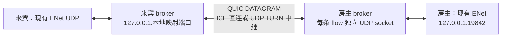

# oheco broker 承载互联网 ENet 的可行性分析

本轮范围：将主菜单“网络”改名为“局域网”；互联网部分仅审阅源码、接口及既有验收材料，没有实现桥接、改动 ENet／broker、部署服务或执行穿透／relay 实验。

分析基线：本机 `oheco-broker --version` 为0.5.1；broker源码提交为 `4b94434b36569dec956c4dfe89919e366786c585`，审阅时工作区干净。版本号一致不代表已验证当前安装产物的全部数据面。以下结论区分已存在能力和待验证推论。

## 判断

**传输语义上可行，推荐通过本机 UDP 端口映射保留现有 ENet；完整互联网联机还需要 C# 接入、房间授权和掉线策略。**

broker已实现libjuice ICE、STUN、真正的UDP/IPv4 TURN relay，以及保留报文边界的QUIC DATAGRAM UDP映射。它没有公开接管现有ENet socket／FD的接口。现成.NET SDK仅用于本机命令执行，不包含remote peer映射。游戏当前的host权威星形结构适合该代理模型，无需为八人对战改成全互联mesh。

| 项目 | 已确认能力／约束 | 对本项目的含义 |
|---|---|---|
| NAT穿透 | libjuice ICE收集候选、认证交换SDP、建立直连 | 可让broker隧道直连；ENet本身不参与ICE。 |
| relay | Pion真正UDP TURN；auto／never／force策略 | 对穿透失败提供有权限的UDP中继；网络封锁全部UDP时没有TCP/TLS兜底。 |
| UDP映射 | 每个本地源独立flow，远端独立UDP socket，完整报文交付 | 多个ENet客户端可分别连接房主，不会因为同一个目标端口而自动合并。 |
| C# SDK | 当前只有local command execution | 需要新增C SDK桥接，或先由外部CLI维持映射。 |
| 游戏房间 | broker登记、会话、信令；调用者和目标broker必须同tenant | 缺少开箱即用的跨账号游戏房间／邀请授权。 |
| 重连 | 本地map端口可保留，但UDP flow销毁后新建 | 无法承诺原ENet连接不断；游戏层需重新握手、身份恢复及状态同步。 |
| 八人规模 | 房主加7条caller连接；C服务默认max_peers=16 | 连接数量符合默认上限，实际CPU、延迟和吞吐仍需八人验收。 |

## 推荐的传输路径

来宾在broker peer已认证就绪后，创建UDP map，目标为房主本机的ENet监听，再把map返回的本地端口交给现有 `NetworkSession.Join("127.0.0.1", port, ...)`。房主运行broker serve，目标ACL仅允许自己的ENet UDP端口。来宾与房主之间的返回流量沿同一flow反向传递。图中的“直连”是broker加密隧道两端直连，ENet通信仍经两端本机代理。

每位来宾建立一条到房主的broker peer。八人房间需七条来宾—房主连接；不是28条全互联连接。现在游戏按ENet peer ID区分玩家，不依赖远端公网IP进行游戏身份判断，这与代理方向相容。代理会让房主看到本机代理的源IP／临时端口，因此将来不能把该地址作为玩家的互联网身份或封禁依据。

这是对现有接口的接入推论，尚未执行一次ENet-over-broker实验。先完成broker建立再调用游戏Join十分必要：broker初次建立默认可等待30秒，而现有游戏首次连接检查为10秒，不能让两个不同阶段共用当前Join倒计时。

[现有Host／Join实现](../Scripts/NetworkSession.cs#L88-L106)直接使用Godot `ENetMultiplayerPeer.CreateServer/CreateClient`；[Godot对应API](</storage/Users/currentUser/dev/ohos/godot-editor/modules/enet/doc_classes/ENetMultiplayerPeer.xml#L24-L51>)接受普通IP和UDP端口，适合连接本机代理。[公开C映射API](</storage/Users/currentUser/dev/ohos/oheco-broker/sdk/c/remote/ob_remote.h#L141-L153>)仅有固定目标portmap；[远端socket创建](</storage/Users/currentUser/dev/ohos/oheco-broker/sdk/c/remote/peer/mapping.c#L615-L636>)和[按源区分flow](</storage/Users/currentUser/dev/ohos/oheco-broker/sdk/c/remote/peer/mapping.c#L943-L957>)佐证这一路径。没有发现导出ICE socket、复用外部FD或原始datagram回调接口，因而不建议从“把现有ENet socket交给broker”开始设计。

## UDP语义、开销与断线

[协议明确说明](</storage/Users/currentUser/dev/ohos/oheco-broker/docs/PEER-PROTOCOL.md#L431-L463>)：可靠QUIC stream负责UDP flow的OPEN/ACK和生命周期，**UDP业务载荷只用RFC9221 QUIC DATAGRAM**。这保留ENet需要的报文边界和尽力交付语义，没有把业务UDP塞进可靠字节流；QUIC加密、拥塞控制和flow控制建立仍会带来开销。

broker按512字节有效载荷分片，支持最大65,507字节原始UDP；缺任一片则整包丢弃。每flow四个出站排队报文、四个重组槽，排队1秒、重组2秒过期；拥塞或socket背压可以丢包。普通约1400字节ENet UDP包会成为多个broker分片，不能仅凭“最大报文装得下”判断高负载时稳定。后续应测量ENet重传、broker丢弃、QUIC拥塞控制与RTS批量tick广播共同作用。

[TURN源码](</storage/Users/currentUser/dev/ohos/oheco-broker/internal/control/turn.go#L147-L175>)是真实UDP listener及Pion服务；它转发加密后的QUIC UDP数据报，不负责解释ENet。当前[relay边界](</storage/Users/currentUser/dev/ohos/oheco-broker/docs/PEER-PROTOCOL.md#L187-L221>)为UDP/IPv4，没有TURN-over-TCP／TLS或所有NAT成功保证。

**恢复隧道不等于恢复比赛。** broker断线会销毁UDP flow，恢复后远端代理socket源端口可能改变。Godot所用[ENet地址检查](</storage/Users/currentUser/dev/ohos/godot-editor/thirdparty/enet/protocol.c#L1042-L1050>)会拒绝不匹配既有peer源地址／端口的包。broker保留来宾本地监听端口，并不能保证房主端的ENet peer继续有效。

当前游戏[慢客户端保护及断线处理](../Scripts/NetworkSession.cs#L306-L340)在远端落后80ticks时暂停房主推进，20TPS下约为4秒；确认断线后按投降处理。没有重新接管既有玩家席位、快照重同步或主机迁移。所以第一阶段的成功标准应是“建立并完成一局”，无缝重连另列需求；不能套用broker关于TCP原socket恢复的承诺。

## 房间与授权是主要新增工作

broker的tenant／broker／connection／session分别是账号授权、设备入口、逻辑连接和一次传输尝试，不是游戏房间、玩家身份和对局编号。当前游戏局域网广播发现也不会自动穿过固定目标UDP隧道；互联网入口需要独立的房间列表或邀请流程。

[旧session创建路径](</storage/Users/currentUser/dev/ohos/oheco-broker/internal/control/signaling.go#L357-L390>)要求account权限并检查目标broker属于同tenant；[managed connection路径](</storage/Users/currentUser/dev/ohos/oheco-broker/internal/control/connections.go#L273-L274>)也按同tenant约束查询。**每个玩家各自注册独立tenant后，不能直接凭broker ID互连。**

面向朋友联机需要明确设计以下授权链：游戏登录／邀请 → 对指定房间的加入权限 → 指定broker与目标端口的受限连接权限 → 游戏玩家身份与ENet席位绑定。可研究broker增加受限跨tenant邀请／连接授权，或由游戏后端管理broker身份并签发／代理受限会话；后者仍需核对C SDK能否使用预签发权限、刷新和重连接口，不能视为现成方案。不要把租户主令牌或管理权限当作房间邀请发给全部玩家。

broker已具备PAKE、认证信令、证书pin及QUIC TLS，但共享peer密码只证明密码知识，不等同于游戏玩家账号。游戏层仍应把获准玩家与hello／席位关联。

## C#接入与部署选择

| 方案 | 适用阶段 | 主要成本 |
|---|---|---|
| 外部CLI维护本机UDP映射 | 最小可行性实验 | 以手工启动的独立进程先证明ENet数据面；后续若由游戏管理，需要处理就绪、退出、状态、凭据与各平台进程限制。 |
| C SDK＋小型原生桥＋C# P/Invoke或Godot扩展 | 游戏内正式集成的优先候选 | 目标平台原生构建、签名／分发、句柄生命周期、SDK工作线程回调回到游戏主线程、错误和退出清理。 |
| 重写纯C#穿透／QUIC／认证 | 不建议作为本项目起点 | 大量复刻现有成熟native engine，扩大维护和验证范围。 |
| 修改Godot ENet socket后端及broker raw I/O API | 暂无必要 | 涉及引擎和broker两侧接口扩展，现有portmap路线已可先验证。 |

[.NET SDK说明](</storage/Users/currentUser/dev/ohos/oheco-broker/sdk/dotnet/README.md#L1-L5>)明确不含remote peer／portmap；[C SDK说明](</storage/Users/currentUser/dev/ohos/oheco-broker/sdk/c/remote/README.md#L3-L20>)与[CMake输出](</storage/Users/currentUser/dev/ohos/oheco-broker/sdk/c/remote/CMakeLists.txt#L31-L54>)表明现有的是原生静态库源码，需要自行构建桥接产物。与Godot链接时还需核对固定BoringSSL／C++ runtime的符号和ABI，不能假定SDK与Godot内部TLS依赖可直接混用。各依赖许可证及libjuice修改的源码义务见[依赖记录](</storage/Users/currentUser/dev/ohos/oheco-broker/docs/NATIVE-DEPENDENCIES.md>)。

需要有受信HTTPS/WSS控制入口、公网IPv4、STUN/TURN UDP入口与完整relay UDP端口池，配置实际公网地址及防火墙返回路径；安装CLI不会自动部署这些服务。账号批准、relay授权、会话租约和流量配额均需满足。即使走direct，broker的控制心跳和授权租约仍然存在，不能将其视为建立后永久不依赖服务端。具体条件见[部署文档](</storage/Users/currentUser/dev/ohos/oheco-broker/docs/PRODUCTION-DEPLOYMENT.md#L7-L17>)和[控制面契约](</storage/Users/currentUser/dev/ohos/oheco-broker/docs/CONTROL-API.md#L169-L222>)。

## 后续验证计划（本轮未执行）

1. 独立测试身份／服务，先让两端原生CLI建立UDP映射，实际承载现有ENet：大厅、国家／队伍、聊天、开始、命令、胜负及回放；不能只以UDP echo通过作为ENet成功。
2. 跨设备分别强制never直连和force中继；核对实际候选与TURN字节计数，避免auto模式掩盖某条路径失败。再测两种网络／不同NAT；UDP全封锁应准确提示不支持。
3. 房主加7来宾，混合直连／中继，正常tick及大单位指令／大批量tick；记录连接耗时、RTT分位数、抖动、ENet重传、flow队列丢弃、帧推进停顿、CPU／内存和中继流量。
4. 加丢包、重排、带宽限制；校验各端状态散列、独立录像重演和玩家隔离，核对当前80ticks慢客户端保护在互联网环境中的体验。
5. 测断网、Wi-Fi切换、relay／控制服务中断、token刷新／撤销；先验证现有掉线行为，再单独设计重新入场和快照重同步，不能预先承诺无缝恢复。
6. 用各自独立账号验证房间邀请、拒绝未授权加入、过期和踢出；确保所选授权方案无需共享租户主权限。

broker既有[UDP集成测试源码](</storage/Users/currentUser/dev/ohos/oheco-broker/tests/c/remote_peer_test.c#L100-L117>)覆盖多源隔离、零长和512／513／16,384／65,507字节数据；[历史验收索引](</storage/Users/currentUser/dev/ohos/oheco-broker/docs/LOCAL-VALIDATION.md#L33-L48>)记录过direct／force及鸿蒙与Linux公网路径，同时明确快照与丢包限制。当前0.5.1[新增验收范围](</storage/Users/currentUser/dev/ohos/oheco-broker/docs/LOCAL-VALIDATION.md#L5-L11>)未重新覆盖所有公网数据面。以上属于既有证据，不是本轮重跑，也没有Godot／ENet／八人RTS的性能证明。
